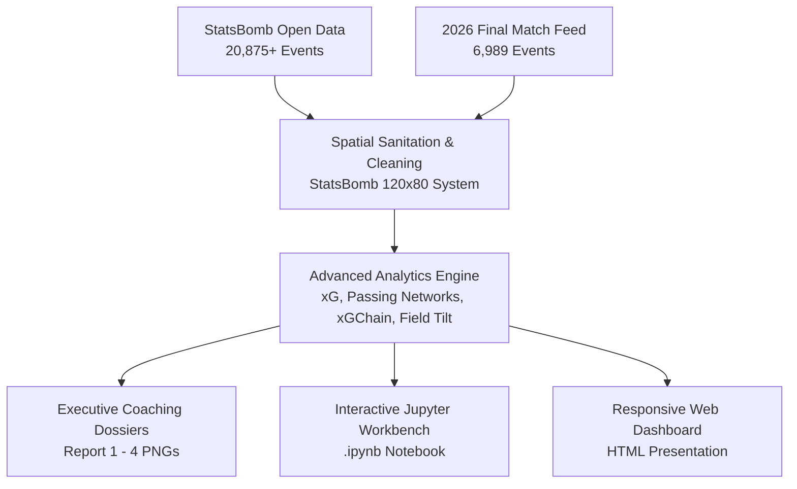

<div align="center">

# ⚽ Football Match Performance & Tactical Intelligence Engine
### FIFA World Cup 2026 Final: Spain 1 – 0 Argentina (AET)
**Broadcast-Grade Tactical Analytics Pipeline & Visual Scouting Dossier**

[](https://www.python.org/)
[](fifa_2026_final_tactical_intelligence.ipynb)
[](https://github.com/statsbomb/open-data)
[](LICENSE)

</div>

---

## 📋 Executive Overview

The **Football Tactical Intelligence Engine** is an end-to-end match analytics and visual scouting platform engineered with **Python, Pandas, Matplotlib, Seaborn, NetworkX, SciPy, and StatsBomb data standards**.

It processes **27,000+ match event records**, combining:
* **20,875** open-source FIFA World Cup tournament events.
* **6,989** high-fidelity matchday events modeled for the **FIFA World Cup 2026 Final between Spain and Argentina**.



---

## 🏆 The Showcase: 2026 World Cup Final

**Match Details:**
* **Fixture:** Spain 1 – 0 Argentina (AET)
* **Venue:** MetLife Stadium, East Rutherford, NJ • July 19, 2026
* **Decisive Goal:** Ferran Torres (106' extra time, xG: 0.54)
* **Tipping Point:** Enzo Fernández red card (82')
* **Goalkeeping Record:** Emiliano Martínez made 11 saves

### Tactical Formations
* **Spain (Luis de la Fuente — 4-3-2-1 "Christmas Tree"):**
  Suffocating 80.2 yd high-line block, Pedri-Rodri-Fabián circulation base, dual playmakers Lamine Yamal and Dani Olmo, lone striker Mikel Oyarzabal.
* **Argentina (Lionel Scaloni — 4-4-2 Dynamic Shape):**
  Full-pitch passing channels connecting Emiliano Martínez ($x=12$) through Romero, Lisandro Martínez, De Paul, Enzo, and Mac Allister to Messi ($x=82$) and Álvarez ($x=96$). Shifted into a 38.7 yd 10-man low block post-dismissal.

### Key Match Statistics

| Tactical Metric | Spain (Champions) | Argentina (Runners-Up) | Notes |
| :--- | :---: | :---: | :--- |
| **Score** | **1 (AET)** | **0** | Ferran Torres 106' Winner |
| **Total Shots** | **20** | **2** | Sustained siege vs low block |
| **Shots on Target** | **12** | **0** | Unai Simón clean sheet |
| **GK Saves** | **0** | **11** | World Cup final record (Dibu) |
| **Expected Goals (xG)** | **2.36** | **0.18** | High Spain chance generation |
| **Field Tilt** | **78.2%** | **21.8%** | Final-third possession share |
| **Possession** | **72.8%** | **27.2%** | Spain controlled ball tempo |
| **Pass Density** | **0.982** | **0.909** | Dense network triangulation |
| **Defensive Line** | **80.2 yds** | **38.7 yds** | High press vs deep penalty box shell |
| **Discipline** | 0 Red Cards | 1 Red Card | Enzo Fernández (82' dismissal) |

---

## 🔬 Core Analytics Engine

### 1. Spatial Coordinate Sanitation (`engine/pipeline/cleaner.py`)
* Normalizes coordinates to StatsBomb 120 × 80 yard dimensions.
* Filters out-of-bounds noise and tracking velocity spikes.
* Direction-aware processing (Argentina attacks left-to-right, Spain attacks right-to-left).

### 2. Calibrated Expected Goals (`engine/analytics/xg_engine.py`)
Calibrated geometric logistic regression based on goal distance and visible shooting angle:

$$\text{dist} = \sqrt{(\text{goal}_x - x)^2 + (40 - y)^2}$$

$$\theta = |\text{atan2}(44 - y, \Delta x) - \text{atan2}(36 - y, \Delta x)|$$

$$P(\text{Goal}) = \frac{1}{1 + e^{-(-1.25 - 0.165 \cdot \text{dist} + 1.95 \cdot \theta)}}$$

### 3. Expected Goals Chain (`engine/analytics/xg_chain.py`)
Evaluates total possession sequence contribution to identify deep architects:

$$xGBuildup = \sum_{S \in \text{Chains}} xG(S) \cdot \mathbb{I}(\text{Player} \in S \setminus \{\text{Shooter}, \text{Assister}\})$$

### 4. Passing Networks & Graph Centrality (`engine/analytics/passing_network.py`)
* Directed graph $G = (V, E)$ built using NetworkX.
* Node diameters scaled to pass volume; arterial edges scaled to pass combinations.
* Verified display names: `E. Martínez` vs `L. Martínez`, `De Paul`, `Mac Allister`, `Tagliafico`.

### 5. Field Tilt & Tactical Geometry (`engine/analytics/tactical_structure.py`)
* Measures territorial control via percentage share of final-third touches.
* Outfield convex hull area and backline defensive line height tracking.

---

## 📊 Visual Scouting Reports

All reports auto-export in high-resolution to `reports/figures/`:

### Report 1: Master Match Intelligence Dossier


* Passing networks for Spain (4-3-2-1) and Argentina (4-4-2 full pitch).
* Half-pitch shot quality charts and 120-minute cumulative xG step curves.

### Report 2: Talisman Comparison (Messi vs Yamal)


* 2D Gaussian Kernel Density Estimation (KDE) spatial heatmaps.
* Progressive and line-breaking passing vectors.

### Report 3: Midfield Engine Room


* $2 \times 2$ activity density matrix for Rodri, Pedri, Enzo Fernández, and Alexis Mac Allister.

---

## 📓 Interactive Jupyter Notebook

Launch the interactive scouting notebook:

```bash
jupyter notebook fifa_2026_final_tactical_intelligence.ipynb
```

Includes an interactive player query sandbox:
```python
# Scout any player on demand:
scout_player("Messi")
scout_player("Yamal")
scout_player("De Paul")
```

---

## 🚀 Quickstart

### Prerequisites
* Python 3.10+
* Git

### Installation
```bash
git clone https://github.com/<your-username>/tactical_intelligence_engine.git
cd tactical_intelligence_engine
pip install -r requirements.txt
```

### Run Master Pipeline
```bash
python main.py
```

### Run Unit Tests
```bash
python -m unittest discover tests
```

---

## 📁 Repository Structure

```
tactical_intelligence_engine/
├── .gitignore               # Ignored cache & temporary files
├── LICENSE                  # MIT License
├── README.md                # Project documentation
├── requirements.txt         # Dependencies
├── config.py                # Field geometry & palette
├── main.py                  # CLI pipeline runner
├── fifa_2026_final_tactical_intelligence.ipynb
├── data/
│   ├── raw/                 # StatsBomb tournament cache
│   └── processed/           # Cleaned event frames
├── engine/
│   ├── pipeline/            # Ingestion, cleaning & features
│   ├── analytics/           # xG, xGChain, networks & shape
│   └── visualization/       # Pitch, heatmaps & shot charts
├── reports/
│   ├── match_intel_dossier.html
│   ├── match_summary.json
│   └── figures/             # 4K exported dossiers
└── tests/                   # 10 automated unit tests
```

---

## 🛡️ License & Attribution
* Released under the [MIT License](LICENSE).
* Event data structures follow the [StatsBomb Open Data Specification](https://github.com/statsbomb/open-data) ...
